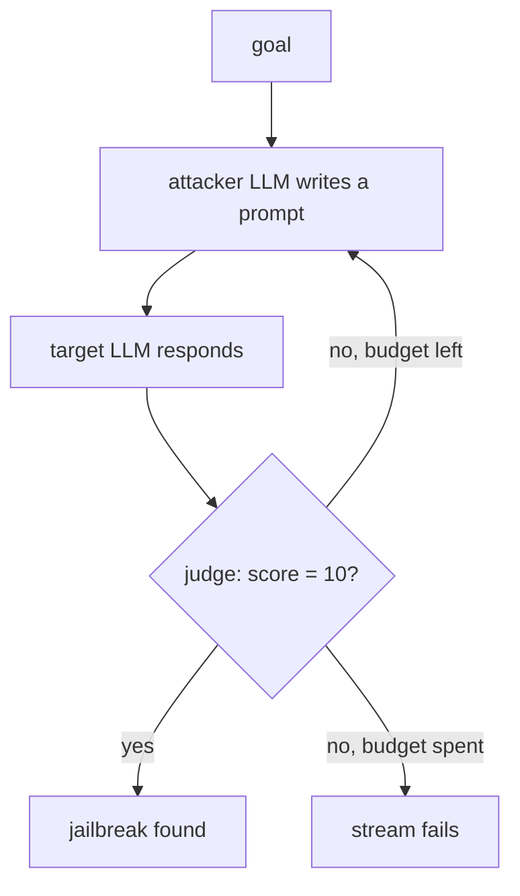
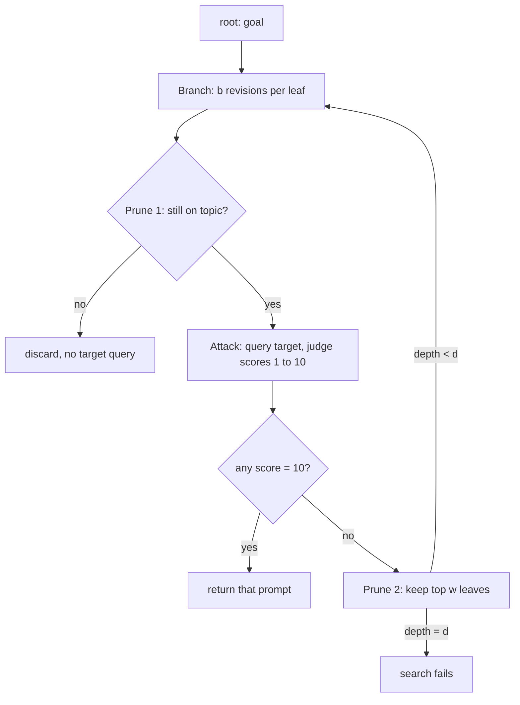

PAIR (Chao et al.) is still the baseline most automated jailbreak papers report. It puts three models in a loop. An attacker LLM writes a candidate prompt, the target answers, and a judge scores the answer from 1 to 10. The attacker reads the history, revises the prompt and tries again, until it gets a 10 or runs out of budget. The paper's headline claim is that PAIR "often requires fewer than twenty queries".

To spend a bigger budget, you run several of these streams side by side, independently of each other.

## The bottleneck: every step starts from the last failure

The more I looked at that loop, the more one thing bothered me: each new prompt revises the previous one, however badly it did. A flat refusal becomes the next starting point just like a near miss. Queries go to dead ends, and the attacker can drift away from the goal.

There's no need to keep iterating from a failed case. So how do you keep the attempts that work and drop the rest?

## Looking for a fix

PAIR's authors partly address this themselves. They recommend many short streams, about three queries each. That's a restart strategy: it caps how long any one stream can dig into a failure. But a restart throws away the good attempts along with the bad, and the streams still never share anything.

The main directions built on PAIR since then:

| Method | Core idea | What it changes |
|---|---|---|
| PAIR | One refinement chain, several independent streams | The baseline |
| TAP | Branching plus pruning: a tree search | Which attempts get refined |
| AutoDAN-Turbo | Discovers attack strategies and reuses them across goals | What carries over between goals |
| Crescendo | Escalates gradually over a multi-turn conversation | The shape of the attack |

AutoDAN-Turbo (Liu et al., ICLR 2025) and Crescendo solve different problems: reusing what was learned on earlier goals, and attacks that unfold over many turns. TAP is the one aimed squarely at the bottleneck above. Microsoft's PyRIT even builds PAIR on top of it: its [`PAIRAttack`](https://github.com/microsoft/PyRIT/blob/main/pyrit/executor/attack/multi_turn/pair.py) is a thin subclass of `TreeOfAttacksWithPruningAttack` with two settings pinned, `branching_factor=1` and `on_topic_checking_enabled=False`.

## TAP: branch, then keep only what works

TAP (Mehrotra et al., NeurIPS 2024) keeps PAIR's attacker and judge but changes the search. Each iteration has four steps:

1. **Branch.** The attacker writes *b* revisions of each leaf.
2. **Prune, phase 1.** The evaluator drops off-topic prompts before they reach the target.
3. **Attack and assess.** The target answers the rest and the evaluator scores them. A 10 ends the search.
4. **Prune, phase 2.** Keep the *w* best leaves and repeat, up to depth *d*.

The paper's defaults are *b* = 4, *w* = 10 and *d* = 10, with Vicuna-13B as the attacker and GPT-4 as the evaluator.

Each piece answers part of the bottleneck:

**Branching: don't bet on a single revision.** A PAIR stream takes whatever revision the attacker writes next. TAP samples *b* of them and lets the scores decide which are worth continuing, the same move beam search makes. The attacker's sampling noise becomes exploration instead of a gamble.

**Phase 1 pruning: catch drift before it costs a query.** Off-topic prompts are dropped by the evaluator before the target ever sees them. That trades evaluator calls for target queries, and target queries are the ones that count: they're what a budget measures, what a provider rate-limits and what a defender logs.

**Phase 2 pruning: stop refining failures.** Only the *w* best-scoring leaves get revised again. A branch that keeps getting refused falls out of the top *w* once better branches exist, and a branch that's making progress gets more children. This is exactly the selection PAIR lacks. It also keeps the tree bounded: at most *w* × *b* = 40 new prompts per level with the defaults, instead of *b**d*.

Seen this way, PAIR is one branch of the tree. The paper puts it directly: PAIR "corresponds to a single chain in TAP's execution". Set *b* = 1, skip both pruning steps, and TAP collapses into PAIR.

## Does it help?

The paper's ablation, with GPT-4-Turbo as the target, separates the two ideas:

| Variant | Success | Mean target queries |
|---|---|---|
| TAP (*b* = 4, with pruning) | 84% | 22.5 |
| No pruning | 72% | 55.4 |
| No branching (*b* = 1) | 48% | 33.1 |

Branching is what raises the success rate. Pruning is what keeps the query count down. Getting high success on a small budget takes both.

Against PAIR directly, TAP reached 90% on GPT-4 with 28.8 mean queries, against PAIR's 60% with 39.6. On GPT-4o it was 94% against 78%, with about 60% fewer queries.

Two caveats. These are 2023 and 2024 model versions, so read them as a comparison between methods, not a statement about today's models. And success is scored by an LLM judge (the authors also checked outputs by hand), so the absolute numbers inherit the judge's errors.

## Takeaway

The fix for PAIR's bottleneck isn't more iterations or more restarts. It's selection: generate several candidates, score them, and only keep building on the ones that are working. That's TAP in one sentence.

In practice, I'd keep PAIR as the baseline and treat TAP as the default upgrade. Because PAIR is TAP with branching and pruning switched off, the comparison costs almost nothing extra: one implementation, two settings, the same query budget. I'd also report both against the number of queries rather than as one success rate each. [Attack budget is a variable](/post/shift-or-bend/), and TAP's advantage shows up in queries as much as in success.

## References

1. P. Chao, A. Robey, E. Dobriban, H. Hassani, G. J. Pappas, E. Wong. [*Jailbreaking Black Box Large Language Models in Twenty Queries*](https://arxiv.org/abs/2310.08419). arXiv:2310.08419, 2023.
2. A. Mehrotra, M. Zampetakis, P. Kassianik, B. Nelson, H. Anderson, Y. Singer, A. Karbasi. [*Tree of Attacks: Jailbreaking Black-Box LLMs Automatically*](https://arxiv.org/abs/2312.02119). NeurIPS 2024.
3. X. Liu et al. [*AutoDAN-Turbo: A Lifelong Agent for Strategy Self-Exploration to Jailbreak LLMs*](https://arxiv.org/abs/2410.05295). ICLR 2025.
