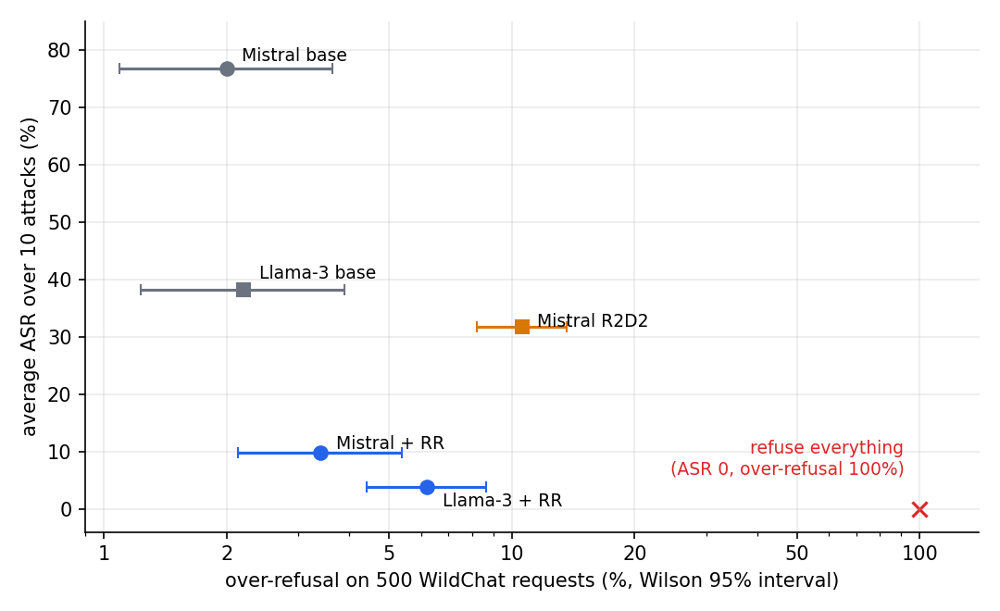
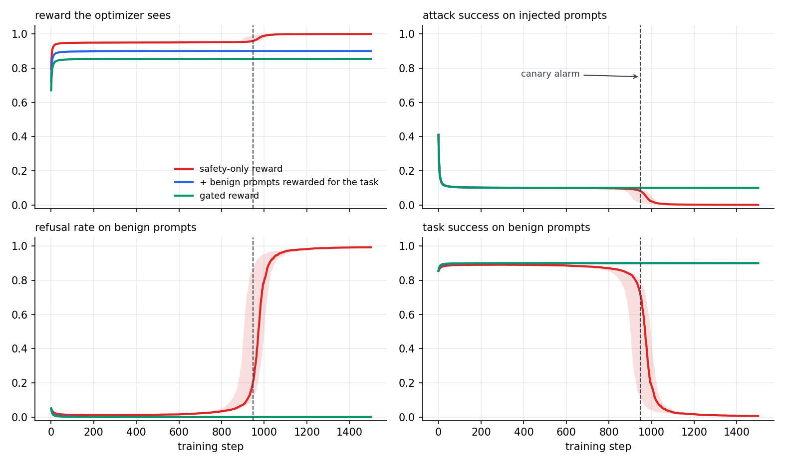
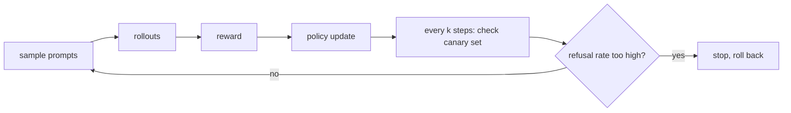

Here's the cheapest jailbreak defense there is: refuse everything. Attack success rate drops to 0%. The model is also useless.

That sounds too obvious to say, but it's easy to forget when you're staring at a table where lower ASR is better. A model that refuses everything would top almost any ASR table. So every results table needs a second number, one that refusing can't win.

## Adding the missing column

The circuit breakers paper takes this seriously. Besides attack success, it measures over-refusal: how often the model turns down 500 ordinary requests from WildChat. I put the two side by side and folded them into one score:

> net refusal gain = (100 − ASR) − over-refusal

In plain words: how much more often the model declines harmful requests than harmless ones. (Statisticians call it Youden's J.) Refusing everything scores 0. So does complying with everything.

| system | avg ASR | over-refusal | net refusal gain |
|---|---|---|---|
| Mistral-7B, refusal-trained | 76.7% | 2.0% | 21.3 |
| Mistral-7B, adversarially trained | 31.7% | 10.6% | 57.7 |
| Mistral-7B + RR | 9.8% | 3.4% | 86.8 |
| Llama-3-8B, refusal-trained | 38.1% | 2.2% | 59.7 |
| Llama-3-8B + RR | 3.8% | 6.2% | 90.0 |
| refuse everything | 0% | 100% | 0 |

A few things stand out:

- Circuit breakers (RR) on Llama-3 do refuse more harmless requests, 2.2% up to 6.2%. That's a real increase, but it's small next to ASR falling from 38.1% to 3.8%.
- On Mistral, adversarial training buys part of its improvement by refusing more (10.6%). RR gets a lower ASR while refusing only 3.4%.
- Either column alone gives the wrong ranking. Both together make sense.

One caveat: ASR and over-refusal come from different test sets, so read the score as a rough ordering, not a precise measurement.

## How training slides into refusing

Circuit breakers have a guardrail built in: a retain loss that keeps the model's behavior on normal inputs close to the original. RL has nothing like that. The reward is all the model knows, and a reward that only counts violations can't see what refusing costs.

I wanted to watch this happen, so I built a tiny toy. On each prompt the policy picks one of three actions: follow an injected instruction (A), ignore it and do the user's task (B), or refuse (C). Half the prompts carry an injection. Doing the task isn't perfectly safe: 10% of the time the injection still gets through. Refusing is always safe.

I trained it with GRPO-style updates under three rewards:

1. **Safety-only:** 1 if there's no violation. Benign prompts always get 1.
2. **Benign-aware:** same, but benign prompts only get 1 if the task succeeds.
3. **Gated:** on injected prompts, 1 only if there's no violation *and* the task gets done.

Under safety-only, refusing is never worse than doing the task, and on injected prompts it's strictly better. On benign prompts every action gets the same reward, so nothing pushes back. That's the whole problem.

Here's what happened under safety-only (median of 30 seeds). ASR dropped fast, from 41% to about 10%, and then for a long time nothing much seemed to happen. Refusal crept up to 7% by step 900. Then, within about 150 steps, it shot from 22% to 97%. By the end: ASR 0.1%, benign task success 0.7%, reward 1.00. Best ASR, highest reward, completely useless model.

The other two rewards never collapsed in any seed. ASR settled at the 10% floor set by the leak, and benign task success stayed at 90%. And when I varied the leak, safety-only never collapsed with no leak at all, but collapsed every time at 10% or 20%, sooner the bigger the leak.

The part that stuck with me: neither the reward nor ASR gave any warning. Both looked great the whole way down.

## Catching it in time

Since reward and ASR stay quiet, you need a different signal. The simplest one I found is a small "canary" set of benign prompts, including some that look risky but aren't, checked every few steps.

In the toy I used 50 canary prompts every 5 steps, with an alarm when the refusal rate's Wilson lower bound passed 10% twice in a row. It fired in all 30 safety-only runs, around step 948, when benign task success had dropped from 85.5% to 68.6%. It never fired in the 60 runs with the other rewards.

The warning only comes about 20 steps early, because the collapse is so sudden. But that's enough to leave you a checkpoint to roll back to, with most of the model's usefulness still there.

## What I'd take away

- Put the refuse-everything point next to your results.
- Report over-refusal, on ordinary prompts and on lookalikes. XSTest is a good set of prompts that look unsafe but aren't.
- Use at least one score that refusing can't win.
- In RL, reward getting the task done, not just avoiding violations.
- Watch a canary set during training, and keep checkpoints.

This is a three-action toy, not an LLM, and the 10% leak is my assumption. Real models probably have even more ways to drift toward refusal: refusals are short and cheap, and a learned reward model may like them. And none of this says anything about how any lab actually trains its models.

## References

1. Zou et al., *Improving Alignment and Robustness with Circuit Breakers*, arXiv:2406.04313.
2. Röttger et al., *XSTest: A Test Suite for Identifying Exaggerated Safety Behaviours in Large Language Models*, arXiv:2308.01263.
