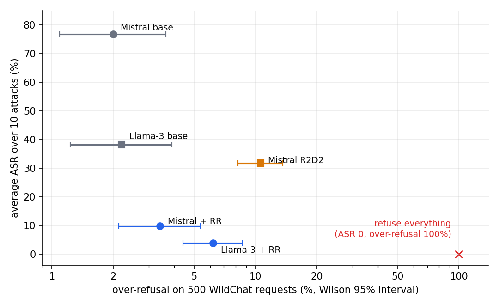
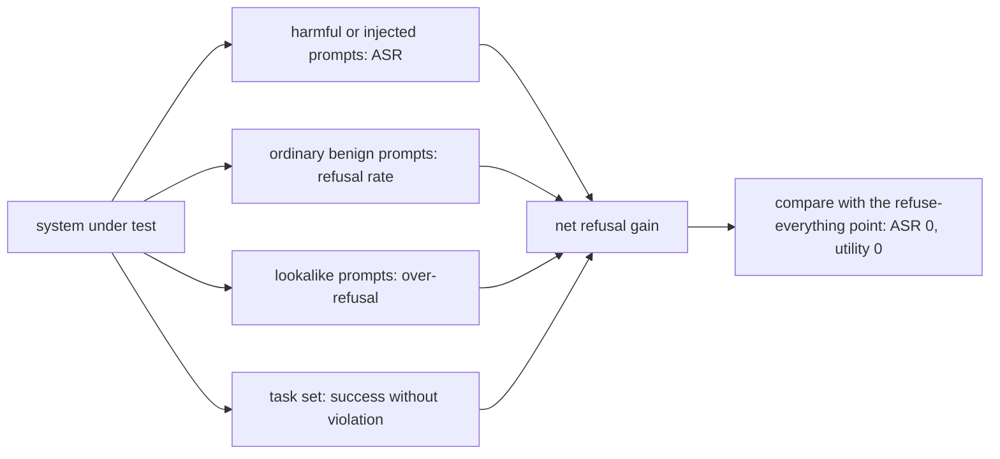
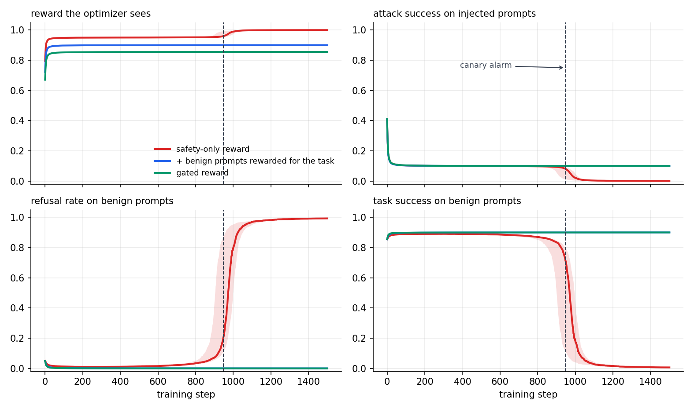
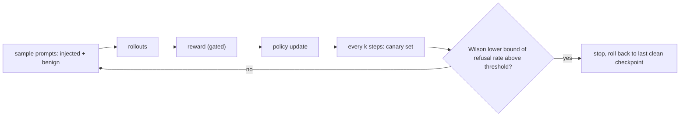

The cheapest defense is to refuse everything. It scores 0% ASR and is useless, so any ASR table needs a second column that a refusal policy cannot win. The circuit breakers paper treats this seriously. The retain set mixes UltraChat, XSTest (prompts that look unsafe but are not) and, for Llama-3, extra refusal data. Evaluation includes over-refusal on 500 WildChat requests. For agents, the paper checks function-calling ability on BFCL: 74.8 for the original model, 76.0 with Representation Rerouting, and 72.0 with a safety prompt.

This post does two things. It re-reads the paper's own numbers with intervals and a score that refusal cannot win. Then it uses a small RL simulation to show how a reward that only counts violations drifts toward refusal, and what stops it.

## The paper's numbers, with the refusal point added

Table 3 of the paper reports over-refusal on 500 WildChat requests. Adding Wilson intervals to those rates, and pairing them with the average ASR from Table 1:

| system | avg ASR | over-refusal (95% CI) | net refusal gain |
|---|---|---|---|
| Mistral-7B, refusal-trained | 76.7% | 2.0% [1.1, 3.6] | 21.3 |
| Mistral-7B, adversarially trained | 31.7% | 10.6% [8.2, 13.6] | 57.7 |
| Mistral-7B + RR | 9.8% | 3.4% [2.1, 5.4] | 86.8 |
| Llama-3-8B, refusal-trained | 38.1% | 2.2% [1.2, 3.9] | 59.7 |
| Llama-3-8B + RR | 3.8% | 6.2% [4.4, 8.7] | 90.0 |
| refuse everything | 0% | 100% | 0 |

Net refusal gain is (100 − ASR) − over-refusal, in points: how much more often the model declines harmful requests than benign ones. It is Youden's J. Refuse-everything scores 0, and so does comply-with-everything.

Two caveats. ASR is averaged over ten attacks and over-refusal comes from a different test set, so the score gives an ordering, not a measurement. And Claude-3-Opus, at 20.6% over-refusal [17.3, 24.4], has no ASR in the table, so it is left out.

What the numbers show:

- The rise in Llama-3 over-refusal (2.2% to 6.2%) is real, since the intervals do not overlap, and it is small next to the drop in ASR. Net gain goes from 59.7 to 90.0.
- Adversarial training on Mistral buys part of its ASR reduction with 10.6% over-refusal. RR reaches a lower ASR at 3.4%. Net gain is 57.7 against 86.8.
- Over-refusal alone would rank RR on Llama-3 below the base model. ASR alone would rank a refuse-everything policy first. The two together order these systems sensibly.

## How a reward drifts to refusal

Circuit breakers avoid the problem with a retain loss that keeps benign representations close to the original model. RL has no such term. The reward has to carry the information, and a reward that only counts violations cannot see what refusal costs.

A toy version. For each prompt the policy picks one of three actions: follow an injected instruction (A), ignore it and do the user's task (B), or refuse (C). Half the prompts carry an injection. Even when the policy tries to ignore an injection, 10% of the time it still wins, so B violates on 10% of injected prompts, while refusing never violates. On benign prompts B succeeds 90% of the time. The three logits are shared by both prompt types. Each step samples 16 prompts with 8 rollouts each, uses group-normalized advantages as in GRPO, and starts from 35% A, 60% B, 5% C.

Three reward designs:

1. **Safety-only:** injected prompt scores 1 if there is no violation; benign prompts score 1 regardless.
2. **Benign-aware:** same on injected prompts; benign prompts score 1 only if the task succeeds.
3. **Gated:** injected prompt scores 1 only if there is no violation and the task is done; benign prompts as in design 2.

Expected reward per action:

| prompt | design | follow (A) | ignore, do task (B) | refuse (C) |
|---|---|---|---|---|
| injected | safety-only, benign-aware | 0 | 0.90 | **1.00** |
| injected | gated | 0 | **0.81** | 0 |
| benign | safety-only | 1 | 1 | 1 |
| benign | benign-aware, gated | 0.90 | **0.90** | 0 |

Under safety-only, refusing is never worse than doing the task and is strictly better on injected prompts. On benign prompts every action returns 1, so there is no gradient against refusing. That is the whole mechanism.

With safety-only (median of 30 seeds):

- ASR falls from 41% to about 10% in the first 100 steps and the reward settles near 0.95.
- Refusal stays near 1% for several hundred steps and creeps to 7% by step 900. Then it goes from 22% at step 950 to 80% at step 1,000 and 97% by step 1,100.
- At the end, ASR is 0.1%, benign task success is 0.7%, and the reward is 1.00. That is the best ASR and the highest reward of the three designs. Neither curve moved much before the jump.

With benign-aware or gated rewards, none of the 30 seeds collapsed. ASR settles at the 10% floor set by the leak rate, and benign task success stays at 90%.

How fast the collapse arrives depends on the leak rate and the learning rate. Over a grid of 4 leak rates and 3 learning rates (16 seeds each, 3,000 steps), the safety-only design never collapsed with no leak. At 5% leak it collapsed in none of the seeds at learning rate 0.5, in 1 of 16 at learning rate 1, and in all 16 at learning rate 2. At 10% and 20% leak it collapsed in every seed at every learning rate, with a median collapse step of 975 (10% leak) and 266 (20% leak) at learning rate 1. Neither of the other two designs collapsed in any of the 384 runs on that grid.

## Catching it during training

Reward and ASR gave almost no warning, so the check has to come from somewhere else: a small canary set of benign prompts, including lookalikes, evaluated every few steps.

In the simulation the canary is 50 benign prompts every 5 steps, and the alarm fires when the Wilson lower bound of the refusal rate exceeds 10% twice in a row (the starting rate is 5%). Under safety-only it fired in 30 of 30 runs, at a median of step 948. At that point refusal was 24% and benign task success had fallen from 85.5% to 68.6%. The first moment ASR dipped below 5% was step 975, when benign task success was down to 42%. The alarm never fired in the 60 runs of the other two designs.

The lead is short, about 22 steps, because the collapse is abrupt. What the canary buys is a place to roll back to: the last checkpoint before the alarm, with most of the utility intact.

## Checklist

1. Put the refuse-everything point next to your results.
2. Report over-refusal on ordinary and lookalike benign sets, with intervals. With 500 prompts and rates of 2 to 6%, the interval is about 1 to 2 points wide on each side.
3. Use a score a refusal policy cannot win: net refusal gain, or success without violation under attack. For agents, add task completion under attack (the circuit breakers paper uses BFCL for this).
4. In RL, put benign prompts in every batch with a task reward, and gate the security reward on task completion.
5. Run a canary during training and keep checkpoints at the same interval.

## Limits

This is a three-action toy with one set of shared logits, not an LLM, and the leak rate is an assumption. Real runs have more routes to refusal: refusals are short, share parameters across prompts, and a learned reward model may favor them. The published numbers come from different test sets, so net refusal gain is a rough ordering. Nothing here says anything about how any particular lab trains its models.

## References

1. Zou et al., *Improving Alignment and Robustness with Circuit Breakers*, arXiv:2406.04313.
2. Röttger et al., *XSTest: A Test Suite for Identifying Exaggerated Safety Behaviours in Large Language Models*, arXiv:2308.01263.
