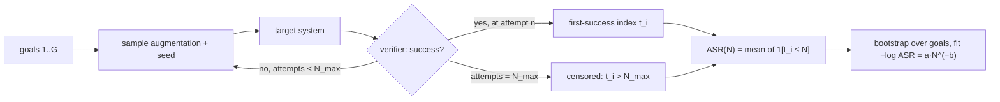
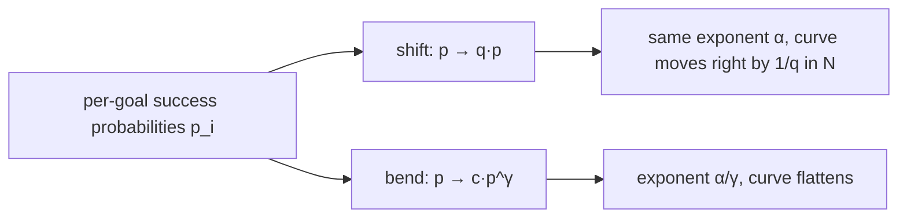
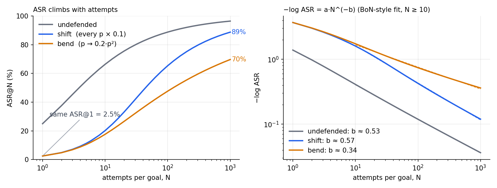
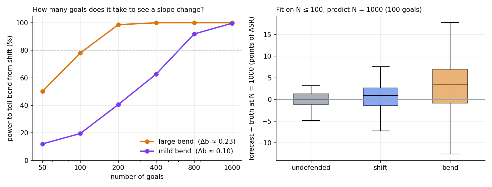

Defense results usually come as one number per attack: success rate with one attempt per goal. In the circuit breakers paper, Representation Rerouting takes Llama-3-8B-Instruct from 38.1% to 3.8% average ASR, and the Cygnet variant to 0.8%. Gray Swan's agent red-teaming competition, run with the UK AI Security Institute, collected 1.8 million attacks on 22 agents. On the ART benchmark built from it, nearly all of the 19 models evaluated violated policy on most target behaviors within 10 to 100 queries. Best-of-N (BoN) jailbreaking draws the same picture as a curve. Against Llama-3-8B-Instruct-RR it reaches 52% ASR after 10,000 attempts.

The number of attempts is a variable, so a defense is better described by how ASR grows with it. The question here is narrow. When a defense lowers single-attempt ASR, does it only move the curve, or does it change the slope?

## A small model of the curve

Give every goal *i* a per-attempt success probability *p<sub>i</sub>*. Attempts are independent given the goal, so the number of attempts until the first success is geometric, and

```
ASR(N) = mean over goals of [ 1 − (1 − p_i)^N ]
```

Goals differ by orders of magnitude in *p<sub>i</sub>* (BoN's per-request histograms span several decades), and the hardest goals decide the tail. If the density of *p* near zero behaves like *p*<sup>α−1</sup>, as it does for a Beta(α, β) distribution, the unbroken fraction decays as a power law:

```
1 − ASR(N) ≈ C · N^(−α)
```

This is the regime where BoN's empirical fit, −log ASR = a·N<sup>−b</sup>, holds. The exponent is what matters: it says how much extra attacker effort each additional point of ASR costs.



The measurement is the BoN procedure: run each goal until it breaks or reaches N<sub>max</sub>, record the first-success index, and compute ASR(N) from those indices. The bootstrap resamples goals.

## Two ways a defense can lower ASR@1

Take an undefended system with *p* ~ Beta(0.5, 1.5), which gives 25% ASR on one attempt. Now two defenses, set to the same 2.5% single-attempt ASR:



- **Shift:** every *p* is multiplied by 0.1. For small *p* this moves the curve right by a constant factor in N. The exponent is unchanged, and the attacker pays roughly 10× more attempts at any target ASR.
- **Bend:** *p* → 0.2·*p*². Hard goals get harder faster than easy ones, which lowers the exponent from α to α/2.

| system | ASR@1 | ASR@10 | ASR@100 | ASR@1000 | N50 | fitted b |
|---|---|---|---|---|---|---|
| undefended | 25.0% | 66.4% | 88.8% | 96.4% | 3.8 | 0.53 |
| shift (p × 0.1) | 2.5% | 20.2% | 65.4% | 88.8% | 44 | 0.57 |
| bend (0.2·p²) | 2.5% | 17.6% | 47.7% | 69.7% | 122 | 0.34 |

*N50 is the number of attempts needed to reach 50% ASR. b is the BoN-style fit over N from 10 to 1,000.*



At N = 1 the two defended systems are identical. By N = 100 they are 18 points apart, and N50 is 2.8× higher for the bent one. A single-attempt benchmark cannot tell them apart.

## What the circuit breaker data says

BoN attacked Gray Swan's models directly, so the paper doubles as a test of this question. The reported results:

- **Headline:** Llama-3-8B-Instruct-RR reaches 52% ASR at N = 10,000, against 94% for Llama 3.1 8B.
- **Attacker cost:** in the per-request histograms (which may include classifier false positives), the median request that broke took about 1,500 attempts on the circuit-breaker model and about 35 on the undefended one. 54 of 159 requests survived 10,000 attempts, against none.
- **Difficulty ordering:** the Spearman correlation of per-request difficulty between the circuit-breaker model and the other models is 0.26 to 0.43 (0.32 against its undefended counterpart). Between most other pairs it is 0.6 to 0.8, and two seeds of the circuit-breaker run correlate at 0.71.
- **Cygnet:** ASR is 5% in the standard setup and 67% when the system prompt makes the model copy the garbled formatting of the input. The authors note that most flagged responses contained harmful text before the model's own short-circuit message.

A uniform shift multiplies every *p* by the same factor, so the difficulty ordering survives apart from sampling noise. A correlation this far below the seed-to-seed value suggests circuit breakers do something other than scale difficulty: they change which requests are hard. One of the BoN authors also wrote in a public comment that circuit breaking moves the exponent somewhat, while adversarial training in the many-shot jailbreaking paper only moved the intercept. That is a comment, not a result.

The Cygnet numbers carry a second lesson. What counts as success matters as much as N. If leaked text before a cutoff counts, the curve moves.

## How well can you measure the exponent?

Less well than the curves suggest. I simulated G goals, each attacked up to 1,000 times, fitted b with BoN's recipe (log-spaced N ≥ 10, regression of log(−log ASR) on log N), and repeated that a few hundred times.



- **Power to tell a bend from a shift** (two-sided, 5%): for a large bend (Δb ≈ 0.23), 78% with 100 goals and 99% with 200. For a mild bend (p → 0.128·p<sup>1.3</sup>, Δb ≈ 0.10), 20% with 100 goals, 63% with 400, and 92% with 800. A hundred-goal benchmark can see a large change in slope and will usually miss a modest one.
- **Forecasting:** fitting on N ≤ 100 with 100 goals and predicting ASR@1000 gives a median absolute error of 1.3 points (undefended), 2.2 (shift), and 4.6 (bend). The bent curve is over-predicted by about 3 points on average, and 300 goals instead of 100 does not remove that (3.5). BoN reports a 4.6-point average forecast error and notes that its forecasts under-predict when final ASR is high. Here the sign is the opposite, which is a reminder that the power-law form is an approximation.
- **Zeros:** a defense with a true single-attempt ASR of 2.5% shows 0 successes in 100 goals about 8% of the time (0.975<sup>100</sup>). With 0 of 100, the one-sided 95% upper bound is about 3%. A 0.0 in a table describes the sample.

## What I would report

1. ASR at N = 1, 10, 100 and 1,000, with bootstrap intervals over goals.
2. N50 and its ratio to the undefended system, which is the attacker's cost multiplier.
3. The fitted exponent, only when ASR at N<sub>max</sub> is high enough to constrain it, with its interval.
4. The definition of success, including partial leakage before a cutoff.
5. The number of goals, and the smallest slope difference that number can resolve.

## Limits

The curves come from a toy model (Beta-distributed difficulty, independent attempts), not from attacks on real defended models. Real attempts are correlated through the augmentation family and the model's state, and real difficulty distributions need not be Beta-like. The circuit-breaker numbers are as reported in the BoN paper. The actual test is to run the same procedure, with one verifier, against defended and undefended checkpoints.

## Reproduce

```python
import numpy as np

def first_success(p, n_max, rng):
    """Attempts until the first success for each goal; n_max + 1 means not broken."""
    with np.errstate(divide="ignore"):
        t = np.ceil(np.log(rng.random(p.shape)) / np.log1p(-p))
    return np.minimum(t, n_max + 1)

def asr_curve(t, grid):
    return np.array([(t <= n).mean() for n in grid])

def fit_b(grid, asr, n_min=10):
    m = (grid >= n_min) & (asr > 0) & (asr < 1)
    slope, intercept = np.polyfit(np.log(grid[m]), np.log(-np.log(asr[m])), 1)
    return -slope, np.exp(intercept)          # b, a

def bootstrap_b(t, grid, reps=1000, seed=0):
    rng = np.random.default_rng(seed)
    bs = [fit_b(grid, asr_curve(t[rng.integers(0, len(t), len(t))], grid))[0]
          for _ in range(reps)]
    return np.nanpercentile(bs, [2.5, 97.5])

rng = np.random.default_rng(1)
grid = np.unique(np.round(np.logspace(0, 3, 31))).astype(int)
p = 0.1 * rng.beta(0.5, 1.5, size=200)        # a "shift" defense, 200 goals
t = first_success(p, 1000, rng)
print(fit_b(grid, asr_curve(t, grid)), bootstrap_b(t, grid))
```

## References

1. Zou et al., *Improving Alignment and Robustness with Circuit Breakers*, arXiv:2406.04313.
2. Hughes et al., *Best-of-N Jailbreaking*, arXiv:2412.03556.
3. Zou et al., *Security Challenges in AI Agent Deployment: Insights from a Large Scale Public Competition*, arXiv:2507.20526.
